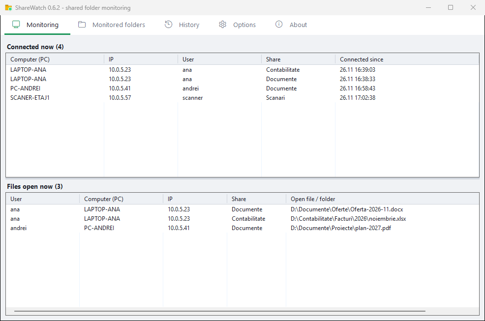
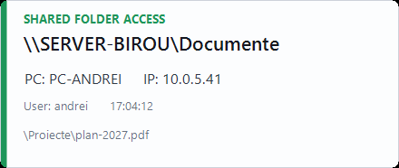
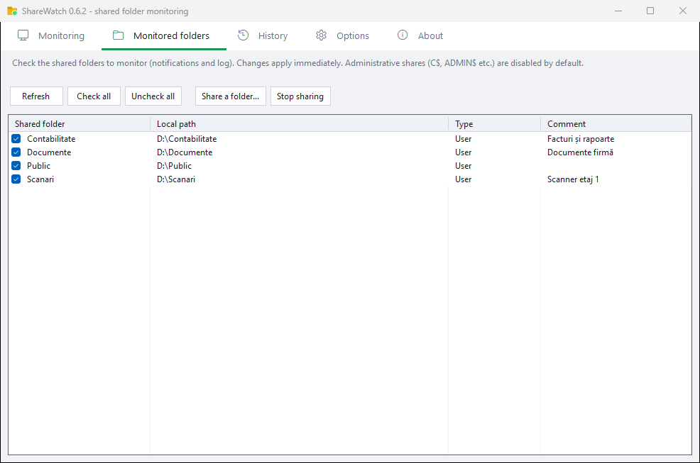
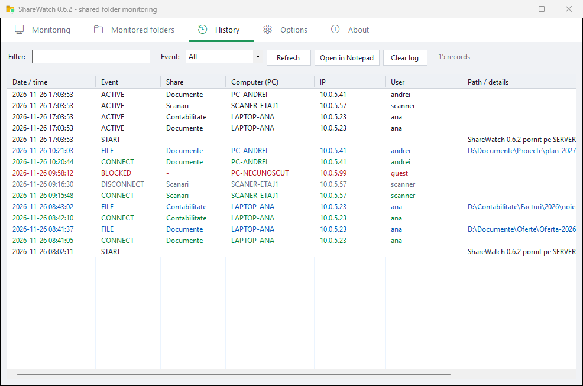
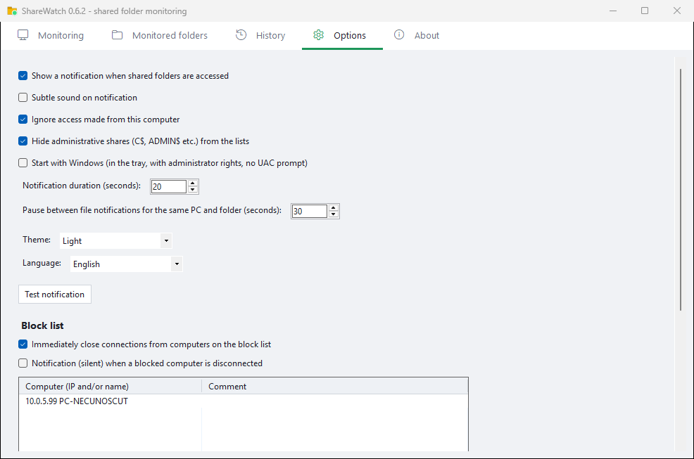
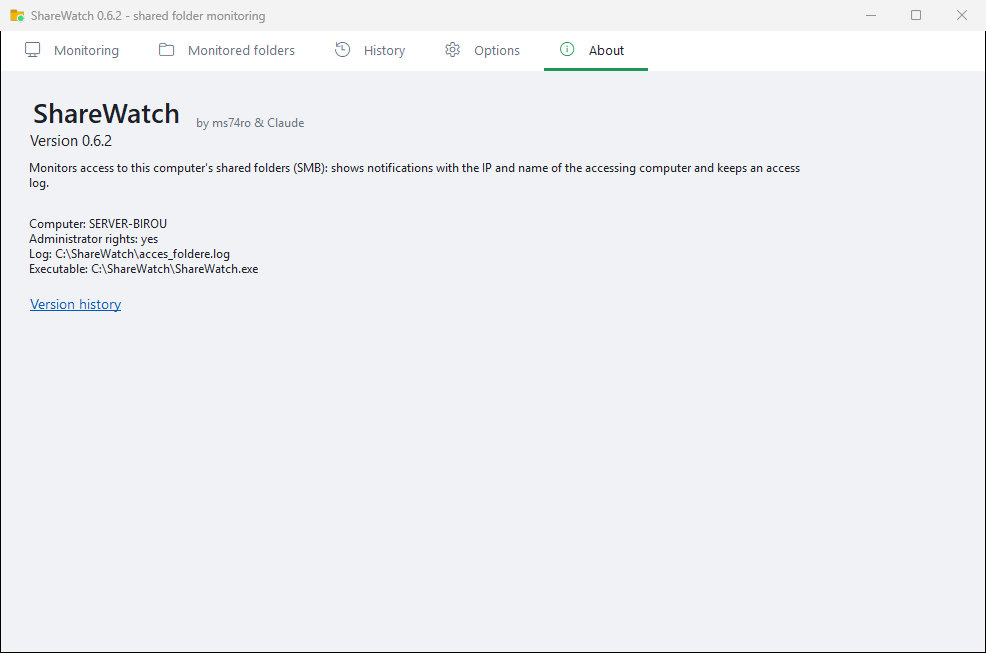

# ShareWatch

[Română](README.ro.md)

ShareWatch is a small Windows tray app that tells you when another computer on the network opens your shared folders. Each notification shows the IP address and the computer name, and every access is written to a log.

It is a single executable with no installer and no dependencies beyond what ships with Windows (.NET Framework 4).



## Screenshots

The examples below use the light theme and made-up data.

| | |
|---|---|
| **Notification** |  |
| **Monitored folders** |  |
| **History** |  |
| **Options** |  |
| **About** |  |

## Features

- **Live notifications** when a computer connects to a shared folder, with IP and computer name, optional subtle sound and configurable duration.
- **Monitoring tab**: the computers connected right now. Right-click one to disconnect or block it.
- **Monitored folders**: choose which shares are watched. Share a new folder or stop sharing one directly from the app.
- **Hide administrative shares** (C$, ADMIN$ etc.) from the lists and tray menu. On by default.
- **Block list**: listed computers are disconnected as soon as they connect. Stored in `blocklist.txt`, editable in the app or in the file.
- **Optional Windows Firewall blocking**: one inbound rule (`ShareWatch - blocare SMB`) blocks TCP 139/445 from blocked IPs.
- **History**: access log in `acces_foldere.log`.
- **Start with Windows** straight to the tray, with administrator rights and no UAC prompt.
- Light / dark / automatic theme; Romanian and English (automatic from Windows).

## Requirements

- Windows 10 or 11 (.NET Framework 4.x, included in Windows).
- Administrator rights. Without them Windows does not let the app see SMB sessions, so monitoring does not work.

## Usage

1. Download `ShareWatch.exe` and put it in a folder of your choice.
2. Run it and accept the administrator prompt.
3. The icon appears in the tray. Double-click it to open the window.

Settings are saved in `sharewatch.ini` next to the executable (or in `%LOCALAPPDATA%\ShareWatch` if that folder is not writable).

## Building

No Visual Studio needed. The script uses `csc.exe` from .NET Framework 4, which is part of Windows:

```powershell
.\build.ps1
```

`.\build.ps1 -Test` builds `ShareWatch-test.exe` without the administrator manifest, for testing the interface only.

The README screenshots come from the test build with made-up shares, computers and log entries (code in `Demo.cs`, compiled only into the test build). Put the test exe in a folder with a `sharewatch.ini` containing `theme=1` and `lang=2` (or `lang=1` for Romanian), then run:

```powershell
.\ShareWatch-test.exe --screenshots .\shots
```

It saves one PNG per tab plus the notification, then exits.

## Files

| File | Contents |
|---|---|
| `ShareWatch.cs` | Entry point, settings, NetApi (shares and sessions) |
| `MainForm.cs` | Main window and tabs |
| `Tray.cs` | Tray icon, menu, monitoring loop |
| `Toast.cs` | Notification window |
| `ShareDialog.cs` | Share / stop sharing a folder |
| `BlockList.cs` | Block list |
| `Firewall.cs` | Windows Firewall rule |
| `Support.cs` | Translations and helpers |
| `Demo.cs` | Made-up data and screenshots (test build only) |
| `build.ps1` | Build script |

## Changes

See [CHANGELOG.md](CHANGELOG.md).
