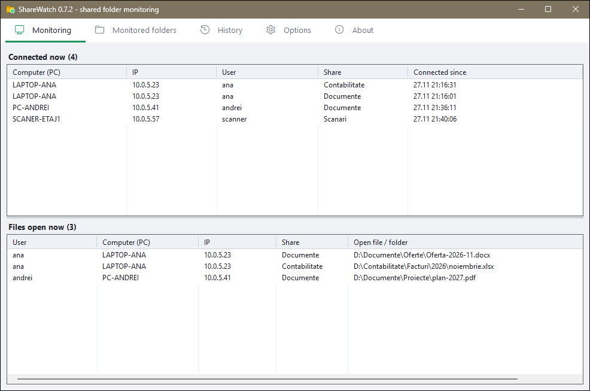

# ShareWatch

[English](README.md)

ShareWatch este o aplicație mică pentru Windows, în tray, care te anunță când un alt calculator din rețea îți deschide folderele partajate. Fiecare notificare arată adresa IP și numele calculatorului, iar fiecare accesare este scrisă într-un jurnal.

Este un singur executabil, fără instalare și fără alte dependențe în afară de ce vine cu Windows (.NET Framework 4).



Alte capturi (în engleză și română, temă luminoasă, date fictive) sunt în [docs/screenshots](docs/screenshots).

## Funcții

- **Notificări în timp real** când un calculator se conectează la un folder partajat, cu IP și nume, sunet discret opțional și durată configurabilă.
- **Tab Monitorizare**: calculatoarele conectate acum. Clic dreapta pe unul pentru a-l deconecta sau bloca.
- **Foldere monitorizate**: alegi ce partajări sunt urmărite. Poți partaja un folder nou sau opri o partajare direct din aplicație.
- **Ascunde partajările administrative** (C$, ADMIN$ etc.) din liste și din meniul tray. Activat implicit.
- **Listă de blocare**: calculatoarele din listă sunt deconectate imediat ce se conectează. Salvată în `blocklist.txt`, editabilă din aplicație sau direct în fișier.
- **Blocare opțională în Windows Firewall**: o regulă de intrare (`ShareWatch - blocare SMB`) blochează TCP 139/445 de la IP-urile blocate.
- **Istoric**: jurnalul accesărilor în `acces_foldere.log`.
- **Pornire automată cu Windows** direct în tray, cu drepturi de administrator și fără UAC.
- Temă luminoasă / întunecată / automată; română și engleză (automat după Windows).

## Cerințe

- Windows 10 sau 11 (.NET Framework 4.x, inclus în Windows).
- Drepturi de administrator. Fără ele Windows nu permite citirea sesiunilor SMB, deci monitorizarea nu funcționează.

## Utilizare

1. Descarcă `ShareWatch.exe` și pune-l într-un folder la alegere.
2. Rulează-l și acceptă cererea de administrator.
3. Iconița apare în tray. Dublu-clic pe ea deschide fereastra.

Setările se salvează în `sharewatch.ini` lângă executabil (sau în `%LOCALAPPDATA%\ShareWatch` dacă folderul nu permite scrierea).

## Compilare

Nu e nevoie de Visual Studio. Scriptul folosește `csc.exe` din .NET Framework 4, inclus în Windows:

```powershell
.\build.ps1
```

`.\build.ps1 -Test` creează `ShareWatch-test.exe` fără manifestul de administrator, doar pentru testarea interfeței.

Capturile din README provin din varianta de test, cu partajări, calculatoare și jurnal fictive (codul e în `Demo.cs`, compilat doar în varianta de test). Pune exe-ul de test într-un folder cu un `sharewatch.ini` care conține `theme=1` și `lang=1` (sau `lang=2` pentru engleză), apoi rulează:

```powershell
.\ShareWatch-test.exe --screenshots .\capturi
```

Salvează câte un PNG pentru fiecare tab și pentru notificare, apoi se închide.

## Fișiere

| Fișier | Conținut |
|---|---|
| `ShareWatch.cs` | Punct de intrare, setări, NetApi (partajări și sesiuni) |
| `MainForm.cs` | Fereastra principală și taburile |
| `Tray.cs` | Iconița din tray, meniul, bucla de monitorizare |
| `Toast.cs` | Fereastra de notificare |
| `ShareDialog.cs` | Partajare / oprire partajare folder |
| `BlockList.cs` | Lista de blocare |
| `Firewall.cs` | Regula din Windows Firewall |
| `Support.cs` | Traduceri și funcții ajutătoare |
| `Demo.cs` | Date fictive și capturi (doar în varianta de test) |
| `build.ps1` | Scriptul de compilare |

## Modificări

Vezi [CHANGELOG.md](CHANGELOG.md) (în engleză).
